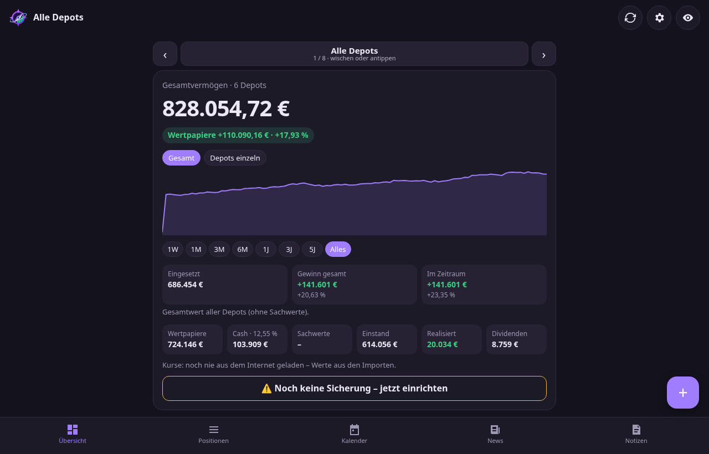

# Depot-Kompass Desktop (Linux, Windows & macOS)

Dieselbe Oberfläche wie die Android-App – lokal im Browser, über Docker. Kalender, Importe (CSV, PDF, Screenshot),
Rechner, Steuer-Übersicht usw. funktionieren genauso. 🇬🇧 [English below](#english)

**Inhalt:** [Datenschutz](#datenschutz) · [Voraussetzungen](#voraussetzungen) · [Installation](#installation) · [Erster Start](#erster-start) ·
[Einstellungen](#einstellungen) · [Heimnetz / Tablet](#heimnetz) · [Starten, Stoppen, Aktualisieren](#bedienung) · [Sichern & Umziehen](#sichern) ·
[Fehlerbehebung](#fehlerbehebung) · [Entfernen](#entfernen)

<a id="datenschutz"></a>
## Datenschutz
- Läuft nur auf deinem Rechner unter `http://127.0.0.1:8098` – nicht im Netzwerk erreichbar, **kein Online-Konto, kein Login**.
- Daten, API-Schlüssel und Original-Dokumente liegen verschlüsselt (AES-256-GCM) im Ordner `daten/`.
  Mit App-PIN ist der Schlüssel zusätzlich mit der PIN geschützt (scrypt). Anders als am Handy gibt es am PC keinen
  Geräteschlüssel: Wer eine Kopie von `daten/` hat, kann die 6-stellige PIN dort in Ruhe durchprobieren. Darum den
  Rechner selbst schützen (Benutzerkonto mit Passwort, Festplattenverschlüsselung wie BitLocker/FileVault/LUKS).
- Sicherungen (`.dksafe`) haben dasselbe Format wie in der Android-App: Handy ↔ PC austauschbar.
- Ins Internet nur auf Knopfdruck (Kurse, News, KI) und nur zu festen Adressen. Internet lässt sich in der App ganz abschalten.

<a id="voraussetzungen"></a>
## Voraussetzungen
| Was | Wofür |
|---|---|
| **Docker** (Linux) bzw. **Docker Desktop** (Windows 10/11 mit WSL 2, macOS mit Apple-Chip oder Intel) | führt die App in einem abgeschlossenen Container aus – [docs.docker.com/get-docker](https://docs.docker.com/get-docker/) |
| ca. **100 MB** freier Speicher (Abbild ca. 70 MB plus deine Daten), im Betrieb ca. 15 MB Arbeitsspeicher (beim Entsperren mit PIN kurz ca. 130 MB) | kleines Python-Abbild (python:3.13-alpine) |
| ein aktueller **Browser** (Firefox, Chrome, Edge, Safari) | die Oberfläche |
| frei: **Port 8098** auf diesem Rechner | Adresse der App (anderer Port: siehe [Einstellungen](#einstellungen)) |
| beim ersten Start **Internet** | Docker lädt das Python-Abbild; danach läuft die App auch ohne Internet |

Kein Python, kein Node, kein Konto nötig – nur Docker.

<a id="installation"></a>
## Installation
Die Desktop-Version nutzt **dieselben App-Dateien** wie die Android-App – nach einem Update hat sie automatisch denselben Stand und dieselbe Versionsnummer.

### Windows (Schritt für Schritt)
1. **Docker Desktop** installieren (docs.docker.com → „Docker Desktop for Windows“) und einmal starten. Fragt die Installation nach **WSL 2**, zustimmen und neu starten.
2. Auf GitHub **Code → Download ZIP** und die ZIP entpacken (z. B. nach `Dokumente\depot-kompass`).
3. Im entpackten Ordner den Unterordner `desktop` öffnen, in die Adresszeile `powershell` tippen und Enter drücken.
4. `docker compose up -d --build` eingeben – beim ersten Mal dauert es ein paar Minuten.
5. Im Browser <http://127.0.0.1:8098> öffnen.

### macOS (Schritt für Schritt)
1. **Docker Desktop for Mac** installieren (Apple-Chip oder Intel – passende Version wählen) und starten.
2. Auf GitHub **Code → Download ZIP** und entpacken.
3. Programm **Terminal** öffnen, `cd ` tippen, den Ordner `desktop` ins Fenster ziehen, Enter.
4. `docker compose up -d --build` eingeben.
5. Im Browser <http://127.0.0.1:8098> öffnen.

### Linux
Docker Engine mit Compose-Plugin installieren (Paket `docker-compose-plugin` bzw. laut docs.docker.com), dann im Ordner `desktop`:

```bash
docker compose up -d --build
```
Dann im Browser öffnen: <http://127.0.0.1:8098>

<a id="erster-start"></a>
## Erster Start


1. Die App zeigt eine kurze **Einführung** – danach landest du in der leeren Übersicht.
2. Daten holen: **Mehr → Import, Kurse & Sichern** → Datei wählen (CSV, PDF oder Screenshot deines Brokers) oder eine `.dksafe`-Sicherung vom Handy einspielen.
3. Ohne eigenes Konto ausprobieren: im Repository liegen erfundene Testdateien unter `testdaten/` (z. B. `testdaten/einzelne_beispiele/`).
4. Optional unter **Mehr → Sicherheit & Sicherung** eine **App-PIN** setzen – dann ist auch der Schlüssel für `daten/` mit der PIN geschützt.
5. Internet nutzt die App erst, wenn du es erlaubst (**Mehr → Datenschutz**).

<a id="einstellungen"></a>
## Einstellungen (Datei `.env`)
Ohne `.env` läuft alles mit sicheren Standardwerten. Für Änderungen eine Textdatei **`.env`** neben `docker-compose.yml` anlegen, eine Zeile je Einstellung, danach `docker compose up -d`.

| Variable | Standard | Bedeutung |
|---|---|---|
| `DK_BIND` | `127.0.0.1` | An welcher Adresse die App lauscht. `127.0.0.1` = nur dieser Rechner. Für Heimnetz: die IP dieses Rechners. **Nie `0.0.0.0`.** |
| `DK_HOSTS` | leer | Zusätzlich erlaubte Adressen in der Browser-Adresszeile, mit Komma getrennt (z. B. Heimnetz-IP und VPN-IP). Andere lehnt die App ab (Schutz gegen DNS-Rebinding). |
| `DK_PORT` | `8098` | Port auf diesem Rechner, falls 8098 schon belegt ist. Die Adresse wird dann `http://127.0.0.1:<DK_PORT>`. |

Fest eingestellt (in `docker-compose.yml`, normalerweise nicht ändern): Zeitzone `TZ=Europe/Berlin`, Datenordner `./daten`, App-Dateien schreibgeschützt eingebunden.

Beispiel `.env` (nur dieser Rechner, anderer Port):
```
DK_PORT=8198
```

<a id="heimnetz"></a>
## Im Heimnetz oder über ein eigenes VPN (z. B. Tablet)
Standard ist nur `127.0.0.1` – niemand außer diesem Rechner kommt dran. Für andere Geräte im **eigenen** Netz in die `.env` (IP dieses Rechners):

```
DK_BIND=<IP dieses Rechners im Heimnetz>
DK_HOSTS=<dieselbe IP>
```

**Vorher eine App-PIN setzen** (am PC unter `http://127.0.0.1:8098`, **Mehr → Sicherheit & Sicherung**). Ohne PIN zeigt die App im Heimnetz nur einen Hinweis und keine Daten.

Dann `docker compose up -d` und am Tablet `http://<IP dieses Rechners>:8098` öffnen. Jeder Browser muss dort einmal die PIN eingeben und bekommt eine eigene Sitzung (12 Stunden, „Sperren“ beendet alle). Ein anderes Gerät im WLAN sieht nur die PIN-Abfrage – auch wenn die App gerade am PC offen ist.

**Wichtig:** Die Verbindung im Heimnetz ist unverschlüsseltes `http`. PIN und Depotdaten gehen lesbar durchs WLAN. Nur in einem eigenen, vertrauenswürdigen Netz nutzen (kein Gäste- oder Firmen-WLAN), besser über ein eigenes VPN (z. B. WireGuard) – das verschlüsselt die Verbindung. **Nie `0.0.0.0` eintragen und am Router keinen Port freigeben.** Unterwegs nur über ein eigenes VPN ins Heimnetz (die VPN-Adresse dieses Rechners zusätzlich in `DK_HOSTS`, mit Komma). Die App holt nur Kurse aus dem Internet, von dort nimmt sie keine Verbindungen an.

<a id="bedienung"></a>
## Starten, Stoppen, Aktualisieren
Alle Befehle im Ordner `desktop` ausführen:

| Was | Befehl |
|---|---|
| Starten (auch nach einem Neustart des Rechners startet die App von selbst) | `docker compose up -d` |
| Stoppen | `docker compose stop` |
| Läuft sie? | `docker compose ps` |
| Meldungen ansehen | `docker compose logs --tail 50` |
| Neu starten | `docker compose restart` |

**Aktualisieren:** neue ZIP von GitHub laden und entpacken, den alten Ordner **`desktop/daten`** in den neuen `desktop`-Ordner kopieren (und eine eigene `.env`), dann im neuen Ordner `docker compose build --pull` und `docker compose up -d` (`--pull` holt auch die Sicherheits-Updates des Python-Abbilds). Wer das Repository mit Git geholt hat: `git pull`, dann dieselben zwei Befehle. Die Daten in `daten/` bleiben dabei erhalten.

**Bilder und Exporte** (Teilen, CSV, Sicherung als Datei) landen am Desktop im **Download-Ordner deines Browsers** – die App sagt kurz Bescheid.

<a id="sichern"></a>
## Sichern & Umziehen
- **Wichtig:** Den Ordner `daten/` regelmäßig sichern (oder in der App eine `.dksafe`-Sicherung anlegen – sie landet in `daten/sicherungen/`).
- Umzug auf einen anderen Rechner: dort installieren wie oben, dann den Ordner `daten/` hinüberkopieren – oder die `.dksafe`-Sicherung in der App einspielen.
- Handy ↔ PC: `.dksafe` vom Handy in der Desktop-App einspielen (und umgekehrt).

<a id="fehlerbehebung"></a>
## Fehlerbehebung
| Problem | Lösung |
|---|---|
| `docker: command not found` / „docker“ unbekannt | Docker Desktop installieren bzw. starten (Windows/macOS: das Wal-Symbol muss laufen). |
| „port is already allocated“ / Seite zeigt eine andere Anwendung | Port 8098 ist belegt → in `.env` z. B. `DK_PORT=8198`, dann `docker compose up -d` und `http://127.0.0.1:8198` öffnen. |
| Seite lädt nicht | `docker compose ps` – läuft `depot-kompass-desktop`? Sonst `docker compose logs --tail 50` lesen und `docker compose up -d` erneut ausführen. |
| Leere Seite mit Fehler 403 | Die Adresse in der Adresszeile ist nicht erlaubt. Mit `http://127.0.0.1:8098` öffnen – oder die verwendete IP in `DK_HOSTS` eintragen. |
| Linux: „Kein Schreibrecht im Ordner daten/“ | im Ordner `desktop` einmal `sudo chown -R 1000:1000 daten`, dann `docker compose up -d`. |
| Windows: „WSL 2 installation is incomplete“ | In Docker Desktop dem Hinweis folgen (WSL-Update installieren) und den Rechner neu starten. |
| Tablet erreicht die App nicht | `DK_BIND` und `DK_HOSTS` auf die Heimnetz-IP dieses Rechners gesetzt? Firewall des Rechners für Port 8098 im Heimnetz freigeben (nicht am Router!). |
| PIN vergessen | Ohne PIN lässt sich der Schlüssel nicht öffnen – eine `.dksafe`-Sicherung (mit ihrem Passwort) in einer frischen Installation einspielen. |

<a id="entfernen"></a>
## Entfernen
`docker compose down` im Ordner `desktop` stoppt und entfernt den Container. Deine Daten bleiben im Ordner `daten/`, bis du ihn selbst löschst – vorher sichern.

## Noch nicht auf dem Desktop
- Verschlüsselte ZIP mit Original-Dokumenten (bitte die `.dksafe`-Sicherung nutzen)
- Benachrichtigungen (gibt es nur in der Android-App)

---

<a id="english"></a>
## English

The same interface as the Android app – locally in your browser via Docker.

**Privacy:** runs only on your computer at `http://127.0.0.1:8098` – not reachable from the network, **no online account, no login**. Data, API keys and original documents are stored encrypted (AES-256-GCM) in `daten/`; with an app PIN the key is additionally protected by the PIN (scrypt). Unlike the phone there is no device key on a PC: anyone with a copy of `daten/` can try all 6-digit PINs offline, so protect the computer itself (user password, disk encryption such as BitLocker/FileVault/LUKS). Backups (`.dksafe`) use the same format as the Android app. Internet only at the push of a button and only to fixed addresses; it can be switched off completely.

**Requirements:** Docker (Linux) or Docker Desktop (Windows 10/11 with WSL 2, macOS Apple chip or Intel), about 100 MB disk space (image about 70 MB, about 15 MB RAM while running), a current browser, free port 8098, internet on the first start (Docker downloads the Python image). No Python, Node or account needed.

**Install:** download the repository as ZIP (Code → Download ZIP) and unpack it, open a terminal in the `desktop` folder (Windows: type `powershell` into the folder's address bar; macOS: Terminal, `cd `, drag the folder in) and run `docker compose up -d --build`, then open <http://127.0.0.1:8098>. The desktop version uses the same app files as Android, so it always has the same version.


**First start:** a short introduction, then import a file (More → Import, prices & backup) or a `.dksafe` backup from your phone. Made-up test files are in `testdaten/`. Optionally set an app PIN (More → Security & backup).

**Settings (`.env` next to `docker-compose.yml`, one line each, then `docker compose up -d`):**
| Variable | Default | Meaning |
|---|---|---|
| `DK_BIND` | `127.0.0.1` | Address the app listens on. For your home network: this computer's IP. **Never `0.0.0.0`.** |
| `DK_HOSTS` | empty | Additional allowed addresses in the browser's address bar, comma-separated (home network IP, VPN IP). Others are rejected (DNS rebinding protection). |
| `DK_PORT` | `8098` | Port on this computer if 8098 is already in use; the address becomes `http://127.0.0.1:<DK_PORT>`. |

**Home network / own VPN (e.g. tablet):** set `DK_BIND` and `DK_HOSTS` to this computer's home network IP, **set an app PIN first** (on the PC at `http://127.0.0.1:8098`, More → Security & backup – without a PIN the app shows only a notice on the home network), then open `http://<IP>:8098` on the tablet. Every browser enters the PIN once and gets its own session (12 hours, “Lock” ends all). **The home network connection is plain `http`:** PIN and data cross your Wi-Fi unencrypted – only use a trusted network of your own, preferably through your own VPN (e.g. WireGuard). **Never use `0.0.0.0` and never forward a port on your router.** When away, only via your own VPN into your home network (add the VPN address to `DK_HOSTS`).

**Start / stop / update** (in the `desktop` folder): start `docker compose up -d` (also starts again after a reboot), stop `docker compose stop`, status `docker compose ps`, messages `docker compose logs --tail 50`. Update: unpack the new ZIP, copy your old `desktop/daten` folder (and `.env`) into the new `desktop` folder, then `docker compose build --pull` and `docker compose up -d` (`--pull` also fetches security updates of the Python image; with Git: `git pull`, then the same two commands). Images and exports end up in your **browser's download folder**.

**Back up** the `daten/` folder regularly or create a `.dksafe` backup in the app (stored in `daten/sicherungen/`). To move to another computer, copy `daten/` or import the `.dksafe` backup.

**Troubleshooting:** “port is already allocated” → `DK_PORT=8198` in `.env`. Page does not load → `docker compose ps` and `docker compose logs --tail 50`. Error 403 → open `http://127.0.0.1:8098` or add the address to `DK_HOSTS`. Linux “no write permission in daten/” → `sudo chown -R 1000:1000 daten` in the `desktop` folder. Windows “WSL 2 installation is incomplete” → follow Docker Desktop's hint and reboot. Tablet cannot connect → check `DK_BIND`/`DK_HOSTS` and allow port 8098 in this computer's firewall for the home network (not on the router). Forgotten PIN → import a `.dksafe` backup (with its password) into a fresh installation.

**Remove:** `docker compose down` removes the container; your data stays in `daten/` until you delete it yourself.

Not yet on desktop: encrypted ZIP with originals, notifications (Android only).
